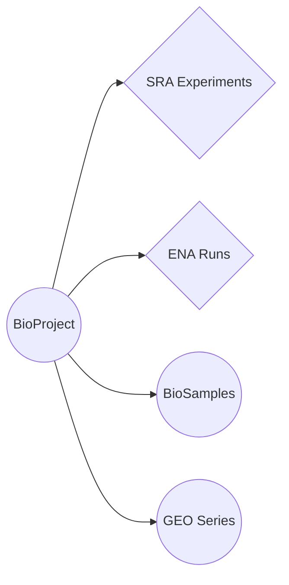

!!! note "Earlier exploration note"
    The first sketch of the accession graph, drawn by hand. [Accession types](graph/accession-types.md) is the authoritative vocabulary and [the route matrix](routes/index.md) the authoritative set of edges — both generated from the code that ships.

